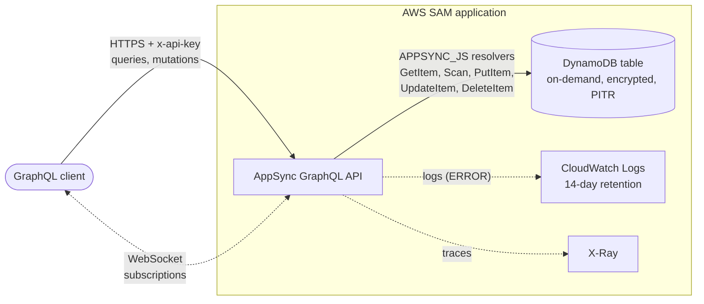

# Serverless GraphQL API using AppSync and DynamoDB

[](https://github.com/bstraehle/aws-appsync/actions/workflows/ci.yml)

An [AWS SAM](https://docs.aws.amazon.com/serverless-application-model/) application that deploys an [AWS AppSync](https://docs.aws.amazon.com/appsync/) GraphQL API backed by an [Amazon DynamoDB](https://docs.aws.amazon.com/dynamodb/) table. JavaScript resolvers ([`resolvers/`](resolvers)) implement get, list, create, update, and delete, and subscriptions push real-time updates over WebSockets.

## Table of Contents

1. [Architecture](#1-architecture)
2. [Prerequisites](#2-prerequisites)
3. [Deploy](#3-deploy)
4. [Use the API](#4-use-the-api)
5. [Clean Up](#5-clean-up)
6. [Development](#6-development)

## 1. Architecture



[`schema.graphql`](schema.graphql) defines a `Demo` type (`id`, `name`, `createdAt`, `updatedAt`):

| Operation | Resolver behavior |
| --- | --- |
| `getDemo(id)` | Returns the item, or `null` if it doesn't exist |
| `listDemos(filter, limit, nextToken)` | Scans the table, with optional `id` and `name` filters (`eq`, `ne`, `beginsWith`, `contains`, `notContains`). `limit` defaults to 20 and is capped at 100; pass `nextToken` to get the next page. |
| `createDemo(input: {name})` | Generates the `id` and timestamps, and trims `name`; a blank name fails with `ValidationError` |
| `updateDemo(input: {id, name})` | Renames the item and updates `updatedAt`; fails with `NotFound` if the item doesn't exist |
| `deleteDemo(input: {id})` | Deletes and returns the item; fails with `NotFound` if it doesn't exist |
| `onCreateDemo(name)`, `onUpdateDemo(id, name)`, `onDeleteDemo(id, name)` | Subscriptions, optionally filtered by the arguments |

> Note: `listDemos` uses a DynamoDB `Scan`, which is fine for a demo but reads the whole table. Filters are applied after reading, so a page can hold fewer than `limit` items while `nextToken` is still set.

## 2. Prerequisites

- An AWS account and the [AWS CLI](https://docs.aws.amazon.com/cli/latest/userguide/getting-started-install.html) with credentials
- [AWS SAM CLI](https://docs.aws.amazon.com/serverless-application-model/latest/developerguide/install-sam-cli.html)
- For the tests: `curl`, [`jq`](https://jqlang.org/download/), and [Node.js](https://nodejs.org/) 22 or later

```shell
git clone https://github.com/bstraehle/aws-appsync.git
cd aws-appsync
```

## 3. Deploy

```shell
sam deploy --guided
```

Choose a stack name (e.g. `aws-appsync`) and region, and accept the defaults. Optional parameters: `LogRetentionInDays` (default 14) and `FieldLogLevel` (default `ERROR`; `ALL` also logs request details).

The stack outputs `GraphQLUrl`, `ApiId`, and `TableName`. Read the API key (it isn't a stack output, so it doesn't appear in CloudFormation):

```shell
STACK=aws-appsync
output() { aws cloudformation describe-stacks --stack-name $STACK --query "Stacks[0].Outputs[?OutputKey=='$1'].OutputValue" --output text; }
GRAPHQL_URL=$(output GraphQLUrl)
API_ID=$(output ApiId)
API_KEY=$(aws appsync list-api-keys --api-id $API_ID --query 'apiKeys[0].id' --output text)
```

**The API key expires 7 days after it's created.** To extend it, by up to 365 days from now:

```shell
aws appsync update-api-key --api-id $API_ID --id $API_KEY --expires $(( $(date +%s) + 30*24*3600 ))
```

## 4. Use the API

Run a query with curl:

```shell
curl -s "$GRAPHQL_URL" -H "x-api-key: $API_KEY" -H 'Content-Type: application/json' \
  -d '{"query": "mutation { createDemo(input: {name: \"Hello, World!\"}) { id name createdAt updatedAt } }"}'

curl -s "$GRAPHQL_URL" -H "x-api-key: $API_KEY" -H 'Content-Type: application/json' \
  -d '{"query": "{ listDemos { items { id name } nextToken } }"}'
```

Or use the Postman collection [`aws-appsync.postman_collection.json`](aws-appsync.postman_collection.json): set the collection variables `graphqlUrl` and `apiKey`, then run the requests in order (`createDemo` stores the new id for the others). You can also use the **Queries** page of the API in the [AppSync console](https://console.aws.amazon.com/appsync/).

Subscriptions only deliver the fields that the triggering mutation selects, and the subscription arguments filter on those fields too. Select all fields of `Demo` in mutations so subscribers get complete items.

End-to-end tests against a deployed stack:

```shell
scripts/smoke-test.sh $STACK                          # queries, mutations, errors, API key check
node scripts/subscription-test.mjs "$GRAPHQL_URL" "$API_KEY"   # onCreateDemo over WebSocket
```

> Note: Right after `sam deploy` updates a resolver, AppSync can take a few seconds to serve the new code.

## 5. Clean Up

```shell
sam delete --stack-name $STACK
```

This deletes the API, the table and its data, and the log group.

## 6. Development

```shell
npm ci
npm run lint                                   # resolvers: APPSYNC_JS runtime rules
pip install -r requirements-dev.txt
cfn-lint -- template.yaml                      # template
sam validate --lint
```

Run a resolver in the AppSync JavaScript runtime without deploying:

```shell
aws appsync evaluate-code --runtime name=APPSYNC_JS,runtimeVersion=1.0.0 \
  --code file://resolvers/listDemos.js --function request \
  --context '{"arguments": {"limit": 500, "filter": {"name": {"beginsWith": "He"}}}}'
```

[CI](.github/workflows/ci.yml) lints the resolvers, the SAM template, and the transformed CloudFormation template. [`.cfnlintrc.yaml`](.cfnlintrc.yaml) explains the two cfn-lint checks that are excluded for the SAM template. CI doesn't deploy; run the end-to-end tests above against your own stack.
